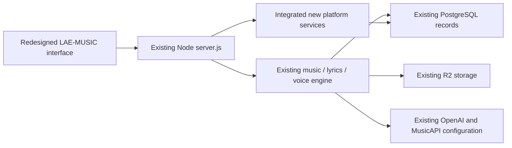

# One LAE-MUSIC platform: existing engine integration audit

## Source versions and limits

Compared the public production branch `main` at `24718b32df138711a73426fb4fd5042767b74f74` with development head `858cb93b77d52adc277f1fef1c43ebc626ca0191`, then integrated the gaps below on the development branch. This is an audit of repository versions. It does not certify that Render currently runs that exact main commit, inspect production records, or establish that every production schema matches repository initialization. Production configuration, database and storage were not changed.

The candidate is an upgrade of the existing Node application. `npm start` still runs `node server.js`. The server's existing PostgreSQL pool, `me`/`listenerMe` authentication, R2 storage/signing functions and provider modules are injected into the shared interface/services. There is no second production API service or replacement catalog/user database.

The Review Sandbox executes this same candidate with isolated temporary test data. It must not be attached to production records or the live bucket for mutation tests. When the completed release is approved, deploy the reviewed code to the existing production service and apply compatible additive migrations to its existing database; do not promote the sandbox database, review Docker image, settings or test balances.

## Existing frontend-to-engine mapping

| Redesigned interface | Existing engine/API retained | Existing records/configuration retained |
| --- | --- | --- |
| Registration, sign-in, account | `/api/register`, `/api/login`, `/api/listener/register`, `/api/listener/login`, `/api/me`, `/api/listener/me`; generic sign-in is an adapter over the same authentication | `creators`, `listeners`, `sessions`, `listener_sessions`; same password hashes and role permissions |
| Discovery, artists, track details and player | `/api/music/tracks`, `/api/music/artists`, `/api/music/artist`, `/api/music/tracks/:id/stream` and cover endpoints; new discovery queries use the existing catalog | `music_tracks`, `creators`, existing object keys and the R2 signing implementation; guest streaming preserved |
| Artist workspace, profile, uploads | Existing subscription, photo, music ownership/upload/finish APIs; added overview/edit/report services share the same pool | `artist_subscriptions`, `artist_studio_usage`, existing profiles/catalog, annual terms and quotas |
| Lyrics studio and saved library | `/api/music/lyrics-generate`, `/api/generation/wallet`, `/api/generation/history` | `generation_wallets`, `generation_ledger`, `generation_records`; existing OpenAI key/model and output contract |
| Music generation, progress and previews | `/api/music/sonic/create`, `/api/music/sonic/status`, existing Sonic module and task protocol | `sonic_test_tasks`, `artist_studio_usage`, existing MusicAPI key, Sonic v6 request settings and artist ownership |
| Existing saved voice selection | `/api/voice/profile` plus explicit `useVoice` on the same music-generation request | Existing `artist_voice_profiles`; the engine resolves the owned persona, never a client-supplied foreign ID |
| Favorites, playlists, follows, comments | Existing listener endpoints and catalog ownership; four relocated moderation routes remain available | Existing listener relationship/comment tables; new revision/audit controls extend those records |
| Partner subscriptions and product links | Existing subscription/referral/product APIs plus verified-sale accounting adapters | Existing creator/referral records and approved commercial terms; new immutable journals are additive |
| Premium, offline, finance and administration | Added services run inside the existing server and receive its pool/auth/storage adapters | Additive checksummed migrations 001–019; no reset, imaginary backfill or automatic conversion of historical balances |

## Audit findings

- All **44 existing initialization table names** found in the baseline remain in candidate initialization. This is a source inventory, not proof of row preservation in an unseen production database. Populated fixture upgrades additionally test exact account/catalog/financial record and credential preservation.
- Of **106 literal `p===...` route entries** inventoried in baseline `server.js`, 102 remain there and four are delegated to `lib/platform.js`: `/api/admin/comment-moderation`, `/api/artist/comment-moderation`, `/api/artist/comment-notifications`, `/api/listener/comment-report`. Runtime regression checks reach those authorized handlers instead of 404. Dynamic routes are covered separately by server/browser journeys; the literal count is not a claim of exhaustive API equivalence.
- `artist-voice.js` matches the baseline apart from trailing whitespace. The existing Sonic module remains the provider engine: earlier candidate changes add idempotency, verified entitlement/hold checks, purchased credits and once-only failure handling rather than replacing provider integration. Existing provider URL, model/task format and owned-voice lookup remain.
- `DATABASE_URL`, R2 account/access/secret/bucket names, `OPENAI_API_KEY`, `OPENAI_LYRICS_MODEL` and `MUSICAPI_API_KEY` remain the configuration sources. No transfer/rotation/recreation is required merely to upgrade the code. Review-only credentials/modes are isolated. Unsafe historical demo financial activation switches remain inactive under the previously approved financial protections; source environment variables were not removed.
- Existing `/artist`, `/artist.html` and `/artist/profile-photo` links still reached older pages. They now use the redesigned catalog/profile workspace, preserving private authorization and backend APIs. Alias resolution also precedes page titles/menu selection, and the old listener-account link selects the authenticated listener profile. The old compatibility source is retained, with default navigation using the new interface.
- The new studio previously hardcoded `useVoice:false`, despite the existing engine's saved-persona option. It now reads the current artist's existing profile and offers an unchecked, explicit selection only when ready. No sample upload, voice recording, training call or R2 test is added.
- Private-release save controls previously offered a storage-dependent action even when the backend reported it unavailable. They now follow `studio_release_import`; standard generation and provider previews remain available without R2. This gate applies to the new durable release feature, not guest streaming or the existing music engine.

Machine-readable inventory: [existing-engine-integration-audit.json](../artifacts/existing-engine-integration-audit.json).

## Verification and remaining issues

The application suite now includes frontend payload, ready/missing/foreign-profile safety, read-only owned voice status, old-URL routing and relocated moderation API checks. The existing provider harness also verifies that explicit voice selection reaches `persona_music` with the backend-owned persona and existing model, and that an unavailable profile fails before a provider call or quota reservation. These provider responses are mocks.

Browser journeys exercise old artist links, saved-voice selection through the existing request, stable generation request keys, standard generation without R2, disabled storage-dependent saving, existing release publication/playback fixtures, artist/listener/auth/finance/admin flows and native offline storage/playback. Existing database/upgrade/security tests remain enabled.

Required verification still outstanding for the **upgraded candidate**, without disputing working live integrations:

1. Complete authorized real MusicAPI generation/output/history/voice behavior through the upgraded interface with an eligible artist entitlement. Do not fabricate paid membership to bypass this gate. Authentication/key presence and mocked success are not this verification.
2. Complete owner-deferred safe final R2 upload/artwork/import/voice-training tests. Review the inherited training route’s sample validation and duplicate-submission protection before exposing a new training interface; that route was preserved, not certified by these read-only/profile adapter tests. Do not connect the sandbox to the live bucket for upload/deletion testing. Existing uploads remain in place.
3. Rehearse migrations on a sanitized actual production-schema copy and verify backup/restore and existing record/object references. Review actual Render PostgreSQL TLS/private-host trust settings without replacing the existing DATABASE_URL or database. Current populated fixtures are not that copy.
4. Finish real gateway checkout/settlement/payout/reconciliation verification and other previously recorded launch gates. Keep approved USD prices, affiliate/royalty rules and financial safeguards unchanged. Historical records are not automatically spendable new-ledger balances.
5. Resolve the previously documented legacy generated-song upload-code entitlement and external-upload quota contradictions before promoting conflicting UI promises. The existing API/code records remain; this audit does not silently change their commercial meaning.
6. Physical phone/Safari/manual accessibility, operational load and final owner review remain required. Candidate code integration and all-green automated tests alone do not authorize production deployment.

See [UPGRADE-EXISTING-SERVICE.md](UPGRADE-EXISTING-SERVICE.md), [FEATURE-STATUS.md](FEATURE-STATUS.md) and [DEPLOYMENT.md](DEPLOYMENT.md). The final target is one upgraded existing LAE-MUSIC platform. No production deployment is performed by this audit.

Read-only HTTPS checks of the live service returned health/music-status 200 with database/storage configuration present. The review service returned 200 with database present and storage disabled as intended. These are presence/health checks, not production upload or streaming verification. No production storage operation was attempted.

## Observed integration verification

Initial integration head `ffe56e7cec211b3d4a0eba4e6282fae809945f99` passed all four jobs in CI run 40416358539. Canonical-navigation follow-up `09a6ab8743bf9d706411bf3d0ab0acebee7972e6` passed 175 native PostgreSQL tests and 8 populated upgrades; its remaining browser jobs are recorded separately when completed. Review-only configuration run 40422449582 passed with unchanged production environment/deployment, no key updates, and null R2 bootstrap/probes.

After that deployment, real HTTPS listener/artist signup, session, logout and opposite-entry-point login checks passed again. `/artist`, `/artist.html` and `/artist/profile-photo` returned the shared frontend (200); the UI adapter was served as JavaScript; existing music/lyrics provider configuration remained present. Review release imports/payments remained disabled as expected. These HTTP reads and account tests did not generate music, upload/train voices, touch R2 or process payments.

Follow-up CI run 40422458278 has passed application/Chromium, PostgreSQL and WebKit. Firefox job 121919941874 is still installing dependencies; its test step has not run, so it is not certified for that exact follow-up. The preceding integration candidate passed Firefox as well. CI is retained unchanged; no engine/check was skipped to produce a green result.
